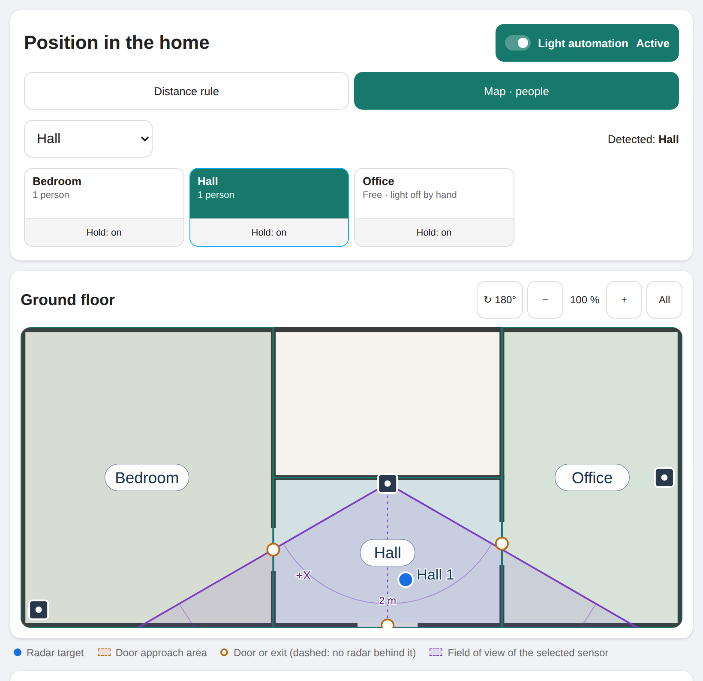

# Radar Occupancy

Room occupancy for Home Assistant from mmWave radar sensors (HLK-LD2450 and
similar) that **does not switch the light off on people who sit still**, and
switches it on as early as the sensors allow.

## The problem

Radar presence sensors lose people who sit or lie still. An automation that
clears the room when presence drops therefore turns the light off at the desk,
on the sofa or in bed, and back on at the next movement. Longer timeouts only
move the problem: the light then stays on long after everybody left.

## The idea

A room is a **latch**. Radar presence sets it; only **evidence of leaving**
clears it. A target that disappears at the desk 1 m from the sensor leaves the
room occupied; a target that disappears at the door frees it.

Two levels build on each other:

| Level | Needs | Gives |
| --- | --- | --- |
| **Distance rule** (per room) | presence + distance of target 1 | room stays occupied until someone vanishes in the *door range* |
| **Map mode** (optional) | X/Y of all targets + a map (robot vacuum or floor plan) | people counted per room through doors, works with several people, lights the next room before you enter |

On top sits the **light control**: switching on when somebody enters, off
after the last person left, soft perceptual fades, a pre-light on approach,
and a light you switched off by hand stays off.

## The way through

1. [Install](installation.md) through HACS and connect your
   [radar sensors](hardware.md).
2. Add a [room](rooms.md) per radar, walk out once and press **Learn door
   from last exit**. This alone fixes the "light off at the desk" problem.
3. Optional: [sub-areas](sub-areas-and-handover.md) such as a balcony seen by
   the room sensor, and handover in single-person homes.
4. Pick the room's light: [light control](light-control.md).
5. Optional, for several people: add *Home*, a [map](maps.md), and
   [calibrate](calibration.md) the sensors on the position card. Then
   [map mode](map-mode.md) counts people through doors.
6. Check it without walking: the [simulation](simulation.md) animates people
   on your map and [measures](measuring-latency.md) when the light comes on.

## Features at a glance

- Still people stay detected: room latch with door range, safety timeout,
  release button.
- Map mode: targets of all sensors fused on a floor map, people counted per
  room, rooms freed only after somebody evidently walked out through a door.
- Lights: on when entering, off after a run-on time, *Only when dark*, time
  window, remembered brightness, fades in CIE L* steps, pre-light on
  approach, full light before entering where the next room's radar already
  sees you, retry for unreliable lamps.
- "Light off" by switch, app, voice or automation sticks, also while somebody
  in bed turns over.
- Position card with live targets, fields of view, doors and calibration
  tools; English and German.
- Simulation with realistic radars (field of view, 1 s report rate, blind
  corners) and a latency measurement.
- Diagnostics download for bug reports.

## Project

- Source and issues: [github.com/ChristophBellmann/ha-radar-occupancy](https://github.com/ChristophBellmann/ha-radar-occupancy)
- Releases and changes: [CHANGELOG.md](https://github.com/ChristophBellmann/ha-radar-occupancy/blob/main/CHANGELOG.md)
- License: Apache-2.0

Deutsch: [Überblick auf Deutsch](deutsch.md).
